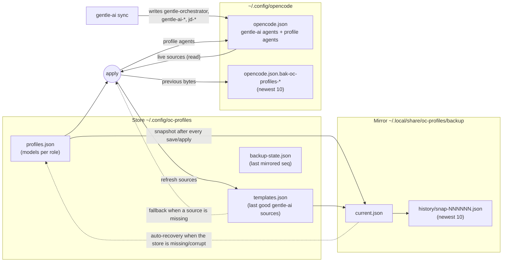
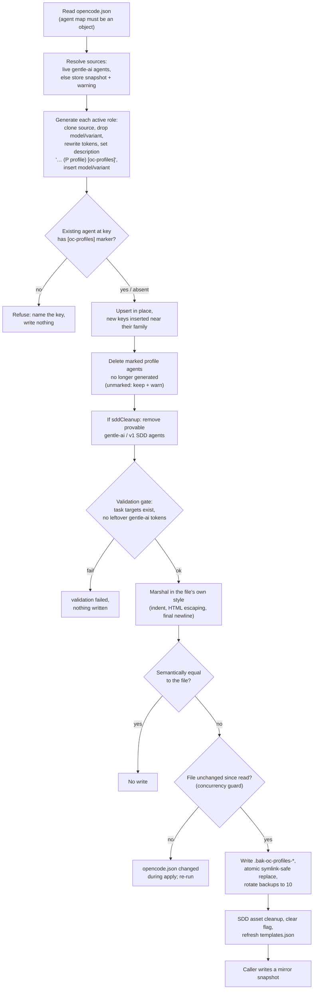

# Architecture

- [Overview](#overview)
- [Packages](#packages)
- [Data model](#data-model)
- [The apply pipeline](#the-apply-pipeline)
- [Backup mirror and recovery](#backup-mirror-and-recovery)
- [SDD → ODD migration](#sdd--odd-migration)
- [Interaction with gentle-ai](#interaction-with-gentle-ai)
- [Design decisions](#design-decisions)

## Overview

oc-profiles owns one thing: **which model and reasoning effort each profile
role uses**. Everything else in a profile agent (prompt, permissions, mode,
description) is derived, on every apply, from gentle-ai's live agents in
`opencode.json`.



## Packages

| Package | Responsibility |
| --- | --- |
| `cmd/oc-profiles` | CLI entry point: flag parsing (flags anywhere), command dispatch, read-only diagnosis vs. auto-recovery, output formatting, rename rollback, version stamping (`main.version`). |
| `internal/core` | The domain. `roles.go` (roles, naming, name rules, token rewrite), `model.go` (profiles, assignments, rename), `render.go` (generate an agent from a source, validation gate), `apply.go` (reconcile `opencode.json`), `importer.go` (import, `opencode.json` reading), `migrate.go` + `legacy.go` (v1 → v2 and the SDD cleanup), `store.go` (store I/O, symlink-safe atomic writes), `paths.go` (locations, env overrides). |
| `internal/ojson` | Order-preserving JSON. Parses objects keeping key order and numbers as `json.Number`, and re-encodes with 2-space indent, optionally HTML-escaped, so untouched parts of `opencode.json` stay byte-identical. |
| `internal/backup` | The mirror: snapshot documents, checksum, history rotation, `Recover`, `Diagnose`, `RestoreSeq`, `Sync`. Depends on `core`. |
| `internal/catalog` | Model discovery: runs `opencode models`, groups by provider (newest first), loads gentle-ai's `model-variants.json` effort cache. |
| `internal/tui` | Bubble Tea UI: `model.go` (state machine and keys), `view.go` (screens), `picker.go` (provider → model → effort picker), `styles.go` (gentle-ai 3.7 Rose Pine styles). |

Dependencies point one way: `cmd` and `tui` → `backup` → `core` → `ojson`;
`tui` → `catalog`.

## Data model

### Roles and agent names

| Role ID (`profiles.json`) | Agent key for profile `P` | Source (live gentle-ai agent) | Optional |
| --- | --- | --- | --- |
| `orchestrator` | `odd-orchestrator-P` | `gentle-orchestrator` | no |
| `explore` | `odd-explore-P` | `gentle-ai-explore` | no |
| `worker` | `odd-worker-P` | `gentle-ai-worker` | no |
| `verify` | `odd-verify-P` | `gentle-ai-verify` | no |
| `jd-judge-a` | `jd-judge-a-P` | `jd-judge-a` | yes |
| `jd-judge-b` | `jd-judge-b-P` | `jd-judge-b` | yes |
| `jd-fix-agent` | `jd-fix-agent-P` | `jd-fix-agent` | yes |

Non-optional roles are always generated; without a model they use OpenCode's
default model. Optional roles are generated only when assigned; otherwise the
profile orchestrator delegates to gentle-ai's global agent. `review-*` agents
are shared, never cloned.

Profile names match `^[a-z0-9]([a-z0-9-]*[a-z0-9])?$` and may not be
`default`, `orchestrator`, `jd-judge-a`, `jd-judge-b` or `jd-fix-agent`.

### Store (schema v2)

`profiles.json`:

```json
{
  "version": 2,
  "sddCleanup": true,
  "profiles": [
    {
      "name": "work",
      "models": {
        "orchestrator": {"model": "anthropic/claude-opus-5-5", "variant": "high"},
        "worker": {"model": "openai/gpt-6.1-sol", "variant": "xhigh"},
        "jd-fix-agent": {"model": "anthropic/claude-sonnet-5-5"}
      }
    }
  ]
}
```

`sddCleanup` is present only between `migrate` and the next successful apply.

`templates.json` holds `{"version": 2, "sources": {...}}`: verbatim copies
of the seven source agents as last seen in `opencode.json`. They are only
used when a source agent is missing from `opencode.json`.

`backup-state.json` holds `{"lastSeq": N}`: the last mirror sequence that
matched the store. `legacy/` (`assets/`, `templates-v1.json`) exists only
between `migrate` and the SDD cleanup.

Loading validates the schema version (older → `migrate`, newer →
`ErrNewerStore`), every profile name, and that names are unique.

## The apply pipeline



### Token rewrite rules

In the profile orchestrator's prompt and in every generated agent's
`permission.task` keys, each source name is replaced by the profile key
(`gentle-ai-worker` → `odd-worker-P`; judges and fix agent only when
assigned). A token is replaced only when:

- it is not adjacent to a slug character (`[A-Za-z0-9_-]`), so
  `gentle-ai-workers` and `my-gentle-ai-worker` are untouched;
- it is not in a path or file-reference context: preceded by `/`, or followed
  by `/`, `:` or `.` + letter/digit (`prompts/gentle-ai-worker.md`,
  `skills/gentle-ai-verify/SKILL.md`, `{file:./gentle-ai-worker.md}`).

A sentence-ending period still rewrites, and so does the config path
`agent.gentle-orchestrator.model`.

### Ownership marker

Apply overwrites or deletes an agent only if its description contains
`[oc-profiles]`. During the post-migration cleanup, gentle-ai 3.7-era
`jd-judge-*-P` agents that equal the v1 snapshot also count as owned.

### Writes

`opencode.json` and the store files are written with a temp file in the
target's directory, fsync, rename and directory fsync. Symlinks are resolved
first, so a dotfiles-managed `opencode.json` stays a link and its target keeps
its mode.

## Backup mirror and recovery

Each snapshot is one JSON document:

| Field | Meaning |
| --- | --- |
| `schema` | Snapshot format version (`1`) |
| `seq` | Monotonically increasing sequence, never reused |
| `createdAt` | UTC timestamp (RFC 3339) |
| `ocProfilesVersion` | Version of the writing binary |
| `sha256` | Hash of the compact JSON of `payload` |
| `payload` | `{"profiles": <profiles.json>, "templates": <templates.json>}` |

`current.json` is the newest snapshot; `history/snap-NNNNNN.json` keeps the
newest 10. A snapshot is skipped when its payload equals `current.json`.
Writes go through temp file, fsync, rename and directory fsync; files are
`0600`.

Recovery precedence (`backup.Recover`, run by mutating commands and the TUI):

1. **Legacy v1 store**: nothing (migration handles it).
2. **Store written by a newer oc-profiles**: refuse; nothing is moved.
3. **Store missing or invalid**: pick the snapshot with the highest `seq`
   (across `current.json` and history) whose checksum verifies **and** whose
   payload is a valid store; stage both files and swap them in, keeping the
   old ones as `*.corrupt-<time>`. No usable snapshot → error, files untouched.
4. **Store valid**: the store wins. If the newest snapshot has a higher `seq`
   than `lastSeq` and different content, warn and change nothing; the next
   save writes the store as a newer snapshot and the other stays in history.

Read-only commands only call `backup.Diagnose`.

## SDD → ODD migration

`core.Migrate` (v1 → v2):

1. Copies the whole store to `<store>.bak-v1-<time>`.
2. Maps each profile (orchestrator ← `sdd-orchestrator`, explore ←
   `sdd-explore`, worker ← `sdd-apply`, verify ← `sdd-verify`, judges ←
   judges).
3. Copies the v1 asset snapshot to `legacy/assets` (kept if it already exists)
   and the v1 `templates.json` to `legacy/templates-v1.json`.
4. Saves the v2 store with `sddCleanup: true`, and only then removes the v1
   `assets/`.

The next apply removes `sdd-*`, `explore` and `general` agents only if they
carry gentle-ai's `__managed_by: gentle-ai/sdd` marker or equal the v1
snapshot (profile agents compared after reproducing the v1 import transform),
and removes SDD prompt/skill files whose bytes equal the snapshot. Everything
else is kept with a warning. It then clears the flag and deletes only the
known children of `legacy/`.

## Interaction with gentle-ai

| Owned by gentle-ai | Owned by oc-profiles |
| --- | --- |
| `gentle-orchestrator`, `gentle-ai-explore/worker/verify`, `jd-judge-a/b`, `jd-fix-agent`, `review-*`, MCP servers, plugins, prompts and skills | Agents at profile keys whose description contains `[oc-profiles]`, the store, the mirror, `opencode.json.bak-oc-profiles-*` |

gentle-ai's sync only removes agents it can prove it generated (a released
description or its ownership marker). Profile agents have new names and
descriptions ending in `(P profile) [oc-profiles]`, which no gentle-ai release
wrote, so sync treats them as user-owned. A full sandboxed
`gentle-ai sync --agent opencode` (4.5.0) kept all profile agents
byte-for-byte. Sync does rewrite `opencode.json` with HTML-escaped strings;
oc-profiles treats formatting-only differences as no change.

oc-profiles never edits gentle-ai's agents. It reads them as templates, so
running `oc-profiles sync` after `gentle-ai sync` propagates upstream prompt
and permission changes into every profile.

## Design decisions

| Decision | Why | Tradeoff |
| --- | --- | --- |
| Generate from **live** gentle-ai agents | Upstream ODD improvements reach every profile | A broken upstream agent breaks profiles too; the validation gate and the `templates.json` fallback limit the damage |
| Store only models and variants | Small source of truth; nothing to merge | Manual edits to profile agents are overwritten |
| Description marker for ownership | Works with gentle-ai's ownership proof; no side files | A user who removes the marker hands the agent back to the user (apply then refuses to touch it) |
| Order-preserving JSON, writing in the file's own style | Minimal diffs; no rewrite for formatting-only differences | A custom encoder to maintain (`internal/ojson`) |
| Whole-token rewrite with path exceptions | Prompts reference agent names in prose and permissions | Unusual phrasings (`gentle-ai-worker: …`) are deliberately not rewritten |
| Store wins over the mirror | Never overwrite user data silently | A newer mirror needs an explicit `backup restore` |
| Read-only commands never recover | `list`/`--dry-run` stay side-effect free | You must run `sync` to repair |
| macOS and Linux only | POSIX permission semantics, symlink handling and directory fsync are tested there; config paths follow XDG | No Windows build |
